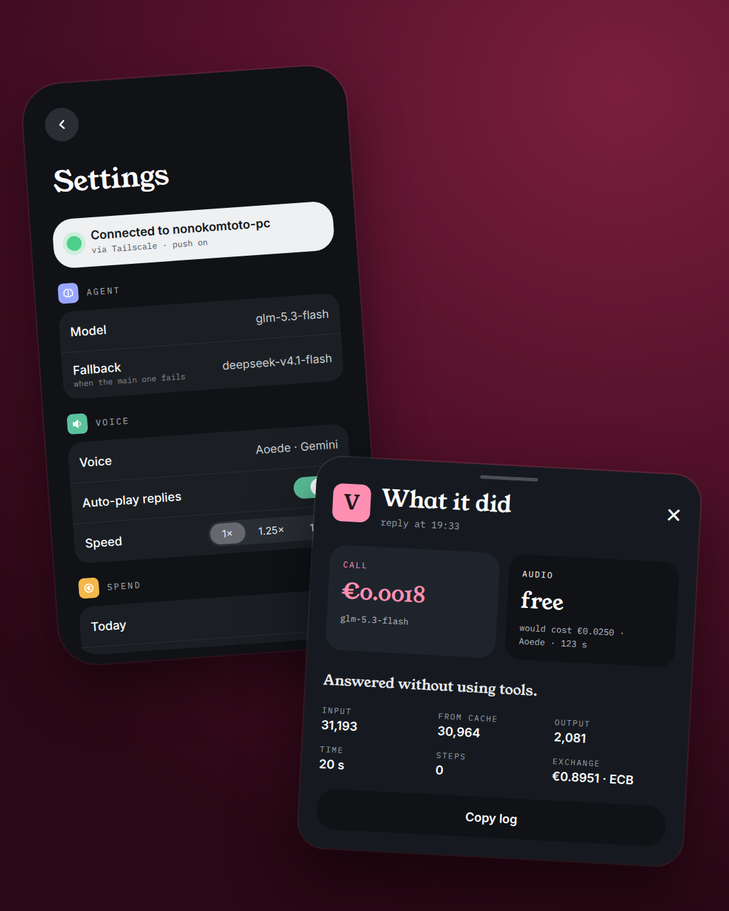

# Hermes Voice (iOS)

A native SwiftUI app to talk to a self-hosted [Hermes Agent](https://github.com/NousResearch/hermes-agent) by voice, plus the small Python services that run next to it on a home Linux server.



## What it does

- **Voice in, on the device.** Dictation uses Apple's Speech framework with on-device recognition when the phone supports it.
- **Voice out.** The agent is told to answer in short spoken sentences and to put links in a separate `Links:` block. A Python service turns the spoken part into audio with Gemini TTS, with Edge TTS as a fallback and the iPhone's own voice as a last resort.
- **Background runs.** Each message is a Hermes run (`POST /v1/runs` with a `session_id` per topic and an `Idempotency-Key`), so the app can be closed. When the app goes to the background it stops streaming and the server sends an APNs push when the run ends or needs approval.
- **Approvals.** Risky tool calls show up as a card in the app, and in the push, to approve or refuse.
- **Usage on every answer.** Model, input/output/cached tokens, steps, time and cost in euros (USD prices from `server/precos.json`, converted at the ECB daily rate).
- **A watcher with no LLM.** `server/scripts/vigia-conductor.py` runs from the Hermes cron every two minutes, looks at an agent-deck conductor session and pushes only when it is stuck on a permission prompt, hits an error, or the fleet has gone quiet after work.

## Architecture

```
iPhone (SwiftUI)
  │  Tailscale only, nothing open to the internet
  ▼
tailscale serve (HTTPS, tailnet)
  ├── /         → Hermes API server        127.0.0.1:8642
  ├── /voz      → server/voz.py  (TTS)     127.0.0.1:8650
  ├── /anexos   → server/voz.py  (photo uploads)
  └── /avisos   → server/avisos.py (device registration, run watching, APNs)

Hermes cron (no_agent, every 2 min) → server/scripts/vigia-conductor.py → APNs
```

The API key lives in the iPhone Keychain. The APNs key stays on the server.

## Layout

| Path | What |
|---|---|
| `Pessoal/` | The iOS app (SwiftUI, iOS 17+). Identifiers and UI copy are in Portuguese. |
| `project.yml` | XcodeGen project. |
| `server/voz.py` | TTS, photo uploads and push endpoints, as a systemd user service. |
| `server/avisos.py` | APNs sender and run watcher. |
| `server/scripts/vigia-conductor.py` | The no-LLM fleet watcher. |
| `ci/`, `.github/workflows/` | Build on macOS runners, sign and upload to TestFlight from a Linux machine. |

## Setup

### Server (Linux, Hermes installed in `~/.hermes`)

1. In your Hermes profile's `.env`, set the values from `server/.env.example`.
2. Run the gateway as a service, then expose it on your tailnet:
   ```sh
   sudo tailscale set --operator=$USER
   tailscale serve --bg --https=443 http://127.0.0.1:8642
   tailscale serve --bg --https=443 --set-path /voz    http://127.0.0.1:8650
   tailscale serve --bg --https=443 --set-path /anexos http://127.0.0.1:8650/anexos
   tailscale serve --bg --https=443 --set-path /avisos http://127.0.0.1:8650/avisos
   ```
3. Voice service: edit `APNS_TOPIC` and the paths in `server/hermes-voz.service`, then
   ```sh
   cp server/hermes-voz.service ~/.config/systemd/user/
   systemctl --user daemon-reload && systemctl --user enable --now hermes-voz
   ```
   Copy `server/persona-pt.md` to `<profile>/voz/persona-pt.md` (it is the voice direction for Gemini TTS; change it for your language).
4. Push: put your APNs key and Team ID in `<profile>/push/` (`AuthKey_<KEYID>.p8`, `equipa.txt`).
5. Watcher (optional): add `vigia-conductor.py` as a Hermes cron job with `no_agent`, with `CONDUCTOR` and `APNS_TOPIC` in its environment.

### App (needs a Mac, or the GitHub Actions workflow)

```sh
brew install xcodegen
xcodegen
open Pessoal.xcodeproj
```

Change `PRODUCT_BUNDLE_IDENTIFIER` in `project.yml`, pick your team, run on an iPhone, and in Settings enter `https://<machine>.<tailnet>.ts.net` and your `API_SERVER_KEY`.

### TestFlight from Linux

Set the repository variable `BUNDLE_ID` and the secrets `APPLE_TEAM_ID`, `ASC_KEY_ID`, `ASC_ISSUER_ID`, `ASC_KEY_P8`. Run `ci/preparar_assinatura.py` once (see its header) to create the distribution certificate and profile as secrets, then run the **iOS** workflow with *TestFlight* ticked.

## Fonts

Roboto, Literata, Young Serif and IBM Plex Mono, all under the SIL Open Font License 1.1 (`Pessoal/Recursos/Fontes/OFL.txt`).

## License

MIT. Hermes Agent is a separate project by Nous Research, also MIT.
